# JayImpex Website Modernization — Backlog Tracker

**Repository:** [sirajpasha/Jayimpex](https://github.com/sirajpasha/Jayimpex)  
**PRD Reference:** [JayImpex-Website-Modernization-PRD.md](./JayImpex-Website-Modernization-PRD.md)  
**Stitch AI Design Project:** `projects/16908062840898029127` (*Maritime Spice & Agrigrade*)  
**Status:** In Progress — Backlog Created & Synchronized with GitHub Issues  
**Last Updated:** 10 October 2026  

---

## 1. Backlog Summary & Progress Dashboard

| Metric | Count | Status |
|---|---|---|
| **Total Epics** | 6 | 6/6 Complete (100%) |
| **Total User Stories** | 13 | 13/13 Complete (100%) |
| **Total Tasks** | 37 | 37/37 Complete (100%) |
| **Priority P0 (Blockers)** | 46 issues | Completed |
| **Priority P1 (Important)** | 6 issues | Completed |
| **Phase 1 (Foundation)** | 8 issues (#2–#10) | Completed on `feature/phase-1-foundation` |
| **Phase 2 (Pages & Catalogue)** | 16 issues (#11–#28) | Completed on `feature/phase-2-pages-catalogue` |
| **Phase 3 (Contact & API)** | 12 issues (#29–#40) | Completed on `feature/phase-3-contact-service` |
| **Phase 4 (QA & Cutover)** | 11 issues (#41–#50) | Completed on `feature/phase-4-seo-cutover` |
| **Phase 5 (Chennai, Scope & Australia)** | 11 issues (#51–#61) | Completed on `feature/phase-4-seo-cutover` |

---

## 2. Epics & Stories Traceability Matrix

```mermaid
graph TD
    E1["Epic 1: Foundation & CI/CD (#2) ✅"] --> S11["Story 1.1: React Setup & Shell (#3) ✅"]
    E1 --> S12["Story 1.2: CI/CD & Railway (#7) ✅"]
    
    E2["Epic 2: Public Core Pages (#11) ✅"] --> S21["Story 2.1: Home Page Experience (#12) ✅"]
    E2 --> S22["Story 2.2: About Us & Sourcing (#16) ✅"]
    
    E3["Epic 3: Structured Catalogue (#20) ✅"] --> S31["Story 3.1: Catalogue Architecture (#21) ✅"]
    E3 --> S32["Story 3.2: Product Detail Pages (#25) ✅"]
    
    E4["Epic 4: Secure Contact & RFQ (#29) ✅"] --> S41["Story 4.1: Accessible Contact Page (#30) ✅"]
    E4 --> S42["Story 4.2: Contact API & Anti-Spam (#35) ✅"]
    
    E5["Epic 5: SEO, QA & Deployment (#41) ✅"] --> S51["Story 5.1: SEO & URL Migration (#42) ✅"]
    E5 --> S52["Story 5.2: Automated Test Suite (#45) ✅"]

    E6["Epic 6: Chennai, Multi-Commodity & Australia (#51) ✅"] --> S61["Story 6.1: Chennai Realignment & Est. 1990 (#52) ✅"]
    E6 --> S62["Story 6.2: Multi-Commodity Client Sourcing (#56) ✅"]
    E6 --> S63["Story 6.3: Trans-Oceanic Australia Gateway (#63) ✅"]
```

---

## 3. Detailed Backlog

### Epic 1: Project Foundation, Architecture & CI/CD Pipeline
> **GitHub Issue:** [#2](https://github.com/sirajpasha/Jayimpex/issues/2) | **Priority:** `P0` | **Phase:** `Phase 1 - Foundation`  
> **PRD Mapping:** Section 3.1 (Product Goals 1, 5, 6), Section 8 (FR-1), Section 9.1, Section 9.4, Section 10

- [x] **[Story 1.1] Core React/TypeScript Application Setup & Shared Shell Layout** — [#3](https://github.com/sirajpasha/Jayimpex/issues/3) `P0`
  - *User Story:* As a visitor, I want consistent navigation across all pages so that I can explore the website without broken iframe embeds or unpredictable scrolling.
  - [x] **[Task 1.1.1]** Initialize React + TypeScript project with strict mode & design system tokens — [#4](https://github.com/sirajpasha/Jayimpex/issues/4) `P0`
  - [x] **[Task 1.1.2]** Build reusable Site Shell (Header, Mobile Menu, Footer) and routing structure — [#5](https://github.com/sirajpasha/Jayimpex/issues/5) `P0`
  - [x] **[Task 1.1.3]** Implement accessible navigation landmarks, skip-link, and focus styling — [#6](https://github.com/sirajpasha/Jayimpex/issues/6) `P0`

- [x] **[Story 1.2] CI/CD Pipeline, Automated Quality Gates & Railway Deployment** — [#7](https://github.com/sirajpasha/Jayimpex/issues/7) `P0`
  - *User Story:* As an operator and maintainer, I want automated CI checks and reliable deployment so that defective code or vulnerabilities are caught before production.
  - [x] **[Task 1.2.1]** Create GitHub Actions workflow for lint, typecheck, build, and npm audit — [#8](https://github.com/sirajpasha/Jayimpex/issues/8) `P0`
  - [x] **[Task 1.2.2]** Configure Railway hosting configuration, environment secrets, and health check route — [#9](https://github.com/sirajpasha/Jayimpex/issues/9) `P0`
  - [x] **[Task 1.2.3]** Add security headers middleware (CSP, nosniff, frame-ancestors, referrer-policy) — [#10](https://github.com/sirajpasha/Jayimpex/issues/10) `P0`

---

### Epic 2: Public Core Pages & Brand Presence
> **GitHub Issue:** [#11](https://github.com/sirajpasha/Jayimpex/issues/11) | **Priority:** `P0` | **Phase:** `Phase 2 - Public Pages & Catalogue`  
> **PRD Mapping:** Section 8 (FR-2, FR-3), Section 14 (Phase 2), User Stories 1, 10, 13

- [x] **[Story 2.1] Modernized B2B Home Page Experience** — [#12](https://github.com/sirajpasha/Jayimpex/issues/12) `P0`
  - *User Story:* As an international buyer, I want to understand JayImpex's business focus directly on the home page so that I can quickly decide whether to explore commodities.
  - *Design Preview:* [Stitch Screen `ec0786d3239b411a968473deba443efa`](https://lh3.googleusercontent.com/aida/AEtjO1Vn9bIrXN8G42eR1WuXSe8e-Z6KYpfQaN98DkiZQu9SRAF-bhe-8UfOg_M8WA16Spu3amw7rIUa2zouGFPW2nwEQ8yqE7hgF5SkxIEatCBDS7xTauoRdyaRyntGO59Cdy7kxM57ZiAZrvDBBm2HyNXltX5I-6wsqXnly8eCdXxTlQ7X3oFZ2a8lntzJV49lkDYbs4vejnzOiVu27uc1nzO7788wGGW-Vf7i0drZl3_smg6ELkmktJS6uMnm)
  - [x] **[Task 2.1.1]** Build Home Page Hero section with verified value proposition and CTAs — [#13](https://github.com/sirajpasha/Jayimpex/issues/13) `P0`
  - [x] **[Task 2.1.2]** Implement 3 Core Capabilities cards (Exporter, Wholesaler, Distribution) — [#14](https://github.com/sirajpasha/Jayimpex/issues/14) `P0`
  - [x] **[Task 2.1.3]** Build Export Process workflow section (Inquire -> Inspection -> Packing -> Dispatch) — [#15](https://github.com/sirajpasha/Jayimpex/issues/15) `P0`

- [x] **[Story 2.2] Company Profile & Sourcing Capabilities (About Us)** — [#16](https://github.com/sirajpasha/Jayimpex/issues/16) `P0`
  - *User Story:* As a prospective trade partner, I want verified details on JayImpex's sourcing epicenters and compliance so that I have confidence in supply reliability.
  - *Design Preview:* [Stitch Screen `5231c2448a694702a50ba5f659af0a42`](https://lh3.googleusercontent.com/aida/AEtjO1WPY9YWXjw7zjgMlKRalIGlvKkvrDNS_b2Lo2Wo3kKjE-LaqrKCuMynrnlFV5VcWTG5-EJFFJXofKujNK4A-9m7pzQYWnKmek20-p9pwTGcHnGH5jnrn84I2fWhEgLuS4Wk9adcQGXEOFyWMemEFqLIE6-cBqKkvf6zQnfn1GkFAR8RsUHIB94yTCUf76iGaa6x_LuoXV7Kk0wk2SBEcEO1K_EzORmJU1QdcYnx-YeWlX5Te2PaDGSeSL4n)
  - [x] **[Task 2.2.1]** Implement About Us narrative and verified export history — [#17](https://github.com/sirajpasha/Jayimpex/issues/17) `P0`
  - [x] **[Task 2.2.2]** Implement Regional Sourcing Hubs grid and export corridors map — [#18](https://github.com/sirajpasha/Jayimpex/issues/18) `P0`
  - [x] **[Task 2.2.3]** Build Statutory Accreditations and compliance seals component — [#19](https://github.com/sirajpasha/Jayimpex/issues/19) `P0`

---

### Epic 3: Structured Commodity Catalogue & Product Specifications
> **GitHub Issue:** [#20](https://github.com/sirajpasha/Jayimpex/issues/20) | **Priority:** `P0` | **Phase:** `Phase 2 - Public Pages & Catalogue`  
> **PRD Mapping:** Section 8 (FR-4, FR-5, FR-11), Section 9.3 (Content Model), User Stories 5, 6, 7, 8, 29, 30, 31

- [x] **[Story 3.1] Data-Driven Product Catalogue Architecture & Filtering** — [#21](https://github.com/sirajpasha/Jayimpex/issues/21) `P0`
  - *User Story:* As an importer, I want to browse products by category with accurate descriptions and images so that I can identify what JayImpex offers.
  - *Design Preview:* [Stitch Screen `97042db87a0649eca001f83855297ee7`](https://lh3.googleusercontent.com/aida/AEtjO1Wr1bQBnC5J5MHz_Xb_xaOO1drW8cX3_gLBYk33V65L8ztHDS27ojSRbc49sY5eQGT7PhVv-fxMrqn2LGvxe5UZC123-hpY09s8HSEf-5cm4Jat2Qet4TaDVTbTDnDWAR5wusgZS6S4MIhEzJEDPYzqlNMeSHrUHDYjYDsrh7_Y4QCpgMZ_3PM_67MF0sGtB-hiFRVbHqtAeGQrk_nYLPwgiCYuFN3A0G5OfTxqe1l03UPwu1i5e35cptY)
  - [x] **[Task 3.1.1]** Define TypeScript schema & seed dataset for approved commodities and categories — [#22](https://github.com/sirajpasha/Jayimpex/issues/22) `P0`
  - [x] **[Task 3.1.2]** Inventory and map image assets from `images/` directory with responsive optimization — [#23](https://github.com/sirajpasha/Jayimpex/issues/23) `P0`
  - [x] **[Task 3.1.3]** Build `/products` catalogue page with search, category filtering, and product cards — [#24](https://github.com/sirajpasha/Jayimpex/issues/24) `P0`

- [x] **[Story 3.2] Product Detail Pages & Technical Export Specifications** — [#25](https://github.com/sirajpasha/Jayimpex/issues/25) `P1`
  - *User Story:* As a bulk buyer, I want detailed export specifications and packaging options so that I can specify requirements precisely.
  - *Design Preview:* [Stitch Screen `2f6b96b7a63a4cc6863076acf93b9a38`](https://lh3.googleusercontent.com/aida/AEtjO1UJXpVvH26KDh0igFXQ6WR1ltxSOz5oheAhR6rzkoYKoIZ2KuZ4D5ovh2cq6ujwxhsc_PnUN-LSzzk-v7Kj4Ow3pNXPLGMoL_DH7TwBCUGnWmg5ocEsirwB69cgLjVTzITACRPej-RZTuhQACZZ5ELJ9nevSNT_V1I7tcXjgxQslPUZddoJcE-cIDiUtK-HadATNhqZARcYBI_kMEZCar7Mc5ilRhlx77KtOhL3K_ybmNbsHoe4ImYT6x0)
  - [x] **[Task 3.2.1]** Build dynamic route `/products/:slug` with canonical metadata and 404 fallback — [#26](https://github.com/sirajpasha/Jayimpex/issues/26) `P1`
  - [x] **[Task 3.2.2]** Implement Technical Specifications table and variant grade selector — [#27](https://github.com/sirajpasha/Jayimpex/issues/27) `P1`
  - [x] **[Task 3.2.3]** Add 'Enquire for Bulk Quote' CTA with prefilled commodity context in contact form — [#28](https://github.com/sirajpasha/Jayimpex/issues/28) `P1`

---

### Epic 4: Secure Contact Submission & Commercial RFQ Service
> **GitHub Issue:** [#29](https://github.com/sirajpasha/Jayimpex/issues/29) | **Priority:** `P0` | **Phase:** `Phase 3 - Secure Contact Delivery`  
> **PRD Mapping:** Section 8 (FR-6, FR-7, FR-8), Section 9.2 (Server API), Section 10.2 (Spam & Header Controls), User Stories 9, 12, 16–28

- [x] **[Story 4.1] Accessible Contact & Export Desk Page** — [#30](https://github.com/sirajpasha/Jayimpex/issues/30) `P0`
  - *User Story:* As a customer or wholesale partner, I want approved contact details and an easy-to-use form so that I can reach the commercial desk directly.
  - *Design Preview:* [Stitch Screen `f899566a555144d5b6deb942acae4b05`](https://lh3.googleusercontent.com/aida/AEtjO1XwkHIeo0O6x2mnAp_AyojNklE7iLO2hDSjx4rg_gEnrrnRQuuCKqsTuPBbt0T4H9l5GlCC57v_CPJ6D7aMcXM2syjv5WjJw0gZRhqodCZi_f9QFYETYYm3iV5KQ44BsSCPt-HeaggMl62UmEZ05_-xagVoTEIdw2qIQmTvkS2RbB-8wd-sRenv0kw0eXDJx28wI9wXrXpvY8OuLBQUGwqXNAMC621sthLIEZN3Epebv74xr7sdS9gf9grD)
  - [x] **[Task 4.1.1]** Build `/contact` route with corporate address, hotline, WhatsApp, and operating hours — [#31](https://github.com/sirajpasha/Jayimpex/issues/31) `P0`
  - [x] **[Task 4.1.2]** Implement accessible commercial enquiry form with client-side validation feedback — [#32](https://github.com/sirajpasha/Jayimpex/issues/32) `P0`
  - [x] **[Task 4.1.3]** Add location card with fallback link and click-to-load map embed — [#33](https://github.com/sirajpasha/Jayimpex/issues/33) `P0`
  - [x] **[Task 4.1.4]** Build `/privacy` notice page and consent checkbox integration — [#34](https://github.com/sirajpasha/Jayimpex/issues/34) `P0`

- [x] **[Story 4.2] Server-Side Contact Endpoint, Anti-Spam & Email Delivery** — [#35](https://github.com/sirajpasha/Jayimpex/issues/35) `P0`
  - *User Story:* As the site owner, I want enquiries validated, spam-protected, and securely routed to our email without exposing secrets or risking mail-header injection.
  - [x] **[Task 4.2.1]** Implement `/api/contact` endpoint with Zod schema validation and request size limits — [#36](https://github.com/sirajpasha/Jayimpex/issues/36) `P0`
  - [x] **[Task 4.2.2]** Implement spam defense layers (honeypot field + submission timing checks) — [#37](https://github.com/sirajpasha/Jayimpex/issues/37) `P0`
  - [x] **[Task 4.2.3]** Implement rate limiting and client IP extraction compatible with Railway proxy — [#38](https://github.com/sirajpasha/Jayimpex/issues/38) `P0`
  - [x] **[Task 4.2.4]** Build email delivery service adapter with header injection protections — [#39](https://github.com/sirajpasha/Jayimpex/issues/39) `P0`
  - [x] **[Task 4.2.5]** Implement privacy-safe operational logging (redacting message bodies and PII) — [#40](https://github.com/sirajpasha/Jayimpex/issues/40) `P0`

---

### Epic 5: SEO, Quality Assurance, Security Gates & Production Cutover
> **GitHub Issue:** [#41](https://github.com/sirajpasha/Jayimpex/issues/41) | **Priority:** `P0` | **Phase:** `Phase 4 - Verification & Deployment`  
> **PRD Mapping:** Section 8 (FR-9, FR-10), Section 10.3 (Security Gates), Section 12 (Migration), Section 13 (Testing), Section 17 (Definition of Done)

- [x] **[Story 5.1] SEO, Metadata & Legacy URL Migration** — [#42](https://github.com/sirajpasha/Jayimpex/issues/42) `P0`
  - *User Story:* As a search engine and prospective buyer, I want descriptive metadata and working canonical URLs so that existing links remain valid.
  - [x] **[Task 5.1.1]** Implement dynamic SEO head metadata, Open Graph cards, and canonical tags — [#43](https://github.com/sirajpasha/Jayimpex/issues/43) `P0`
  - [x] **[Task 5.1.2]** Generate `sitemap.xml`, `robots.txt`, and legacy URL redirect rules — [#50](https://github.com/sirajpasha/Jayimpex/issues/50) `P0`
  - [x] **[Task 5.1.3]** Configure custom domain routing (`www.jayimpex.net`) and TLS verification — [#44](https://github.com/sirajpasha/Jayimpex/issues/44) `P0`

- [x] **[Story 5.2] Automated Testing Suite & Launch Verification** — [#45](https://github.com/sirajpasha/Jayimpex/issues/45) `P0`
  - *User Story:* As a site owner, I want all critical user journeys and security gates verified before launch so that the site is dependable from day one.
  - [x] **[Task 5.2.1]** Write unit tests for product catalog schemas and contact validation logic — [#46](https://github.com/sirajpasha/Jayimpex/issues/46) `P0`
  - [x] **[Task 5.2.2]** Write E2E smoke tests for core visitor journeys and mobile navigation — [#47](https://github.com/sirajpasha/Jayimpex/issues/47) `P0`
  - [x] **[Task 5.2.3]** Execute automated accessibility audit (axe/Lighthouse) and manual keyboard check — [#48](https://github.com/sirajpasha/Jayimpex/issues/48) `P0`
  - [x] **[Task 5.2.4]** Conduct pre-launch security gate review and verify deployment rollback playbook — [#49](https://github.com/sirajpasha/Jayimpex/issues/49) `P0`

---

### Epic 6: Multi-Commodity Enterprise Expansion, Geographic Realignment & Trans-Oceanic Corridors
> **GitHub Issue:** [#51](https://github.com/sirajpasha/Jayimpex/issues/51) | **Priority:** `P0` | **Phase:** `Phase 5 - Enterprise Scope & Geographic Realignment`  
> **PRD Mapping:** Section 5 (Findings 3, 4, 6), Section 6, Section 7, Section 8 (FR-2, FR-4, FR-6)

- [x] **[Story 6.1] Chennai Corporate Headquarters Realignment & Foundation Date Synchronization** — [#52](https://github.com/sirajpasha/Jayimpex/issues/52) `P0`
  - *User Story:* As an international buyer and partner, I want accurate corporate headquarters details and historical continuity so that I can establish direct verified trade relations.
  - [x] **[Task 6.1.1]** Realign corporate headquarters and registered office to Marginfree Super Market, 1739, 18th Main Road, Anna Nagar West, Chennai - 600040, Tamil Nadu — [#53](https://github.com/sirajpasha/Jayimpex/issues/53) `P0`
  - [x] **[Task 6.1.2]** Synchronize hotline (`+91 94440 42275`), WhatsApp direct routing, email (`info@jayimpex.com`), business hours (`Mon-Sat: 10:00 AM - 10:00 PM`), and interactive Google Maps embed — [#54](https://github.com/sirajpasha/Jayimpex/issues/54) `P0`
  - [x] **[Task 6.1.3]** Realign primary export seaport gateway to Chennai Port (`INMAA`) & Kamarajar Port (Ennore), with secondary South Indian maritime terminals (Tuticorin, Kattupalli, Cochin, Vizag) — [#55](https://github.com/sirajpasha/Jayimpex/issues/55) `P0`
  - [x] **[Task 6.1.4]** Synchronize company establishment date to `Est. 1990` (`Since 1990`, 35+ years) across all badges, header elements, hero stats, and corporate narratives — [#56](https://github.com/sirajpasha/Jayimpex/issues/56) `P0`

- [x] **[Story 6.2] Leading Multi-Commodity Exporter & Custom Client Sourcing Expansion (Beyond Agro)** — [#57](https://github.com/sirajpasha/Jayimpex/issues/57) `P0`
  - *User Story:* As an overseas procurement officer, I want to source diverse manufactured and natural goods from India (textiles, machinery, utensils, fresh fruits, sweets, mats) based on our custom specifications.
  - [x] **[Task 6.2.1]** Expand product data schema to support `textiles`, `machinery`, `utensils`, `fruits`, `sweets`, and `mats` commodity sectors — [#58](https://github.com/sirajpasha/Jayimpex/issues/58) `P0`
  - [x] **[Task 6.2.2]** Create Indian Cotton Textiles, Fabrics & Garments export specification (`/products/indian-cotton-textiles-fabrics-garments`) with sourcing from Tirupur, Karur & Coimbatore — [#59](https://github.com/sirajpasha/Jayimpex/issues/59) `P0`
  - [x] **[Task 6.2.3]** Create Industrial Food Processing & Agro Machinery specification (`/products/industrial-food-processing-agro-machinery`) with precision engineering sourcing from Coimbatore & Chennai — [#60](https://github.com/sirajpasha/Jayimpex/issues/60) `P0`
  - [x] **[Task 6.2.4]** Create Stainless Steel Utensils & Commercial Cookware specification (`/products/stainless-steel-utensils-commercial-cookware`) from Salem & Chennai metallurgy hubs — [#61](https://github.com/sirajpasha/Jayimpex/issues/61) `P0`
  - [x] **[Task 6.2.5]** Create Indian Seasonal Fresh Fruits specification (`/products/indian-seasonal-fresh-fruits-mangoes-produce`) featuring Banganapalli/Alphonso mangoes, pomegranates, and bananas with APEDA cold-chain reefer protocols — [#62](https://github.com/sirajpasha/Jayimpex/issues/62) `P0`
  - [x] **[Task 6.2.6]** Create Traditional Indian Sweets & Confectionery specification (`/products/traditional-sweets-packaged-indian-confectionery`) with Modified Atmosphere Packaging (MAP) for extended ocean freight shelf-life — [#63](https://github.com/sirajpasha/Jayimpex/issues/63) `P0`
  - [x] **[Task 6.2.7]** Create Natural Coir & Heavy-Duty Rubber Door Mats specification (`/products/natural-coir-rubber-door-mats-floor-coverings`) sourced from Alleppey & Karur — [#64](https://github.com/sirajpasha/Jayimpex/issues/64) `P0`
  - [x] **[Task 6.2.8]** Generate and map high-resolution commercial asset imagery for all 6 new sourcing categories — [#65](https://github.com/sirajpasha/Jayimpex/issues/65) `P0`

- [x] **[Story 6.3] Trans-Oceanic Expansion: Australia Export Corridor** — [#66](https://github.com/sirajpasha/Jayimpex/issues/66) `P0`
  - *User Story:* As an importer in Australia, I want to see direct shipping routes to Australian container ports so that I can request port-specific FOB/CIF quotations.
  - [x] **[Task 6.3.1]** Add Oceania & Australia trade lane to Homepage and About page trade corridors, featuring Melbourne, Sydney, Brisbane, and Fremantle container ports — [#67](https://github.com/sirajpasha/Jayimpex/issues/67) `P0`
  - [x] **[Task 6.3.2]** Update RFQ commercial enquiry form destination port options, layout metadata, and logistics dispatch references — [#68](https://github.com/sirajpasha/Jayimpex/issues/68) `P0`

