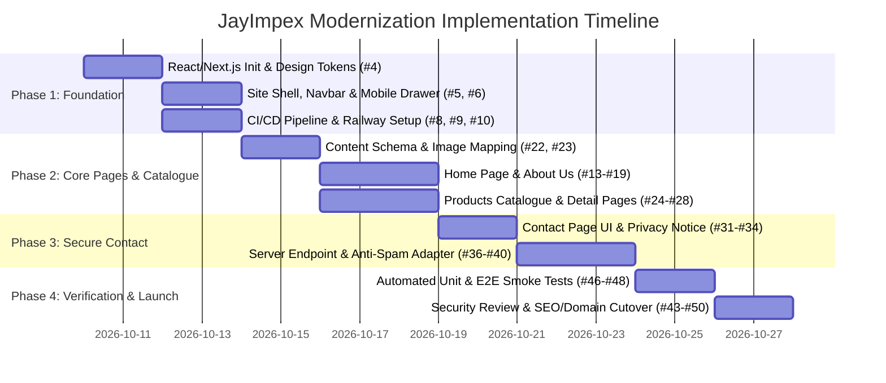

# JayImpex Website Modernization — Implementation Plan

**Version:** 1.0  
**Date:** 10 October 2026  
**Status:** Approved for Execution  
**PRD Reference:** [JayImpex-Website-Modernization-PRD.md](./JayImpex-Website-Modernization-PRD.md)  
**Backlog Tracker:** [BACKLOG.md](./BACKLOG.md)  
**GitHub Repository:** [sirajpasha/Jayimpex](https://github.com/sirajpasha/Jayimpex)  
**Stitch AI Design Reference:** Project `16908062840898029127` (*Maritime Spice & Agrigrade*)  

---

## 1. Executive Summary & Architectural Decisions

The objective of this project is to modernize JayImpex's legacy static website into a maintainable, high-performance, accessible, and secure web application hosted on Railway, retiring the legacy iframe shell and unvalidated PHP mail script.

### 1.1 Architecture & Stack Decisions

| Dimension | Chosen Technology | Rationale & PRD Alignment |
|---|---|---|
| **Frontend Framework** | **Next.js (App Router) / React 19 LTS** with TypeScript | Native Static Site Generation (SSG) for SEO performance, built-in Route Handlers (`/api/contact`), zero iframe overhead, and direct Railway deployment compatibility (PRD §9.1). |
| **Language & Typings** | **TypeScript (Strict Mode)** | Enforces type safety across product schemas, contact validation, and layout components (`strict: true`, `noImplicitAny`). |
| **Styling & Design Tokens** | **Tailwind CSS + CSS Variables** | Implements the Stitch AI *Maritime Spice & Agrigrade* design system (`#0F284E` Ocean Navy, `#D97706` Amber Gold, `#0284C7` Cobalt, `#64748B` Slate). High performance with zero runtime CSS overhead. |
| **Data & Content Layer** | **Version-Controlled JSON (`data/products.json`)** | PRD FR-11: Structured data in version control. Eliminates the complexity and attack surface of a CMS while guaranteeing build-time validation. |
| **Schema Validation** | **Zod** | Validates incoming contact form submissions and verifies product catalogue integrity at build time (PRD §9.2, §10.2). |
| **Spam & Anti-Abuse** | **Honeypot + Timing Token + Rate Limiting** | Layered defense: off-screen honeypot field, encrypted submission timestamp (<3s rejected), and IP-based rate limiting via proxy headers (PRD §10.2). |
| **Email Delivery** | **Resend / Nodemailer via Verified Provider** | Server-side API integration with fixed verified `From` header (`noreply@jayimpex.com`) and sanitized `Reply-To`. Legacy `sendmail.php` is permanently retired. |
| **CI / CD Pipeline** | **GitHub Actions + Railway** | Automated pipeline triggering on pull requests and pushes to `main`: clean install, lint, typecheck, unit tests, build, and vulnerability audits. |

---

## 2. Phased Delivery Roadmap



---

## 3. Detailed Step-by-Step Implementation Plan

### Phase 1: Architecture, Layout Foundation & CI/CD Pipeline
**Goal:** Establish a clean, buildable, deployable React application shell with automated quality gates.

#### Step 1.1: Project Initialization & Configuration
- **GitHub Issues:** [#3](https://github.com/sirajpasha/Jayimpex/issues/3), [#4](https://github.com/sirajpasha/Jayimpex/issues/4)
- **Actions:**
  1. Initialize Next.js with TypeScript and Tailwind CSS in the project root:
     ```bash
     npx -y create-next-app@latest . --typescript --tailwind --eslint --app --src-dir --import-alias "@/*" --use-npm
     ```
  2. Configure `tsconfig.json` with strict mode (`strict: true`, `noImplicitAny: true`, `strictNullChecks: true`).
  3. Define *Maritime Spice & Agrigrade* theme tokens in `tailwind.config.ts`:
     - `primary`: `#0F284E`
     - `secondary`: `#D97706`
     - `tertiary`: `#0284C7`
     - `surface`: `#F8FAFC`
     - `surface-container`: `#E2E8F0`
     - `on-surface`: `#0B1C30`
  4. Import typography fonts (`Inter` for UI, `JetBrains Mono` for tabular trade numbers).

#### Step 1.2: Shared Site Shell & Accessible Navigation
- **GitHub Issues:** [#5](https://github.com/sirajpasha/Jayimpex/issues/5), [#6](https://github.com/sirajpasha/Jayimpex/issues/6)
- **Components to Create:**
  - `src/components/layout/Header.tsx`: Top bar with Chennai trade hotline (`+91 94440 42275`), WhatsApp quick trigger, brand logo, and *Request Export Quote* CTA.
  - `src/components/layout/Navbar.tsx`: Semantic navigation links (`/`, `/about`, `/products`, `/contact`) with active route styling.
  - `src/components/layout/MobileDrawer.tsx`: Accessible slide-over drawer with keyboard trap, escape-to-close, and quick trade call triggers matching Stitch mobile screen `64a9e86cd25e4b079adcf01a2be47e40`.
  - `src/components/layout/Footer.tsx`: Enterprise footer with Anna Nagar West, Chennai office address, statutory accreditations (DGFT IEC: `0490018824`, APEDA, Spices Board, FSSAI), and copyright 2026.
  - `src/components/layout/SkipLink.tsx`: Accessible skip-to-main-content landmark.

#### Step 1.3: CI/CD Pipeline & Railway Setup
- **GitHub Issues:** [#7](https://github.com/sirajpasha/Jayimpex/issues/7), [#8](https://github.com/sirajpasha/Jayimpex/issues/8), [#9](https://github.com/sirajpasha/Jayimpex/issues/9), [#10](https://github.com/sirajpasha/Jayimpex/issues/10)
- **Actions:**
  1. Create `.github/workflows/ci.yml` running on pull requests and pushes to `main`:
     - Clean install (`npm ci`)
     - Typecheck (`tsc --noEmit`)
     - Linter check (`npm run lint`)
     - Unit tests (`npm test`)
     - Production build (`npm run build`)
     - Security audit (`npm audit --audit-level=high`)
  2. Implement health check endpoint `src/app/api/health/route.ts` returning HTTP 200 `{ "status": "ok" }`.
  3. Configure security headers middleware `src/middleware.ts`:
     - `Content-Security-Policy` with narrow allowlist and `frame-ancestors 'none'`.
     - `X-Content-Type-Options: nosniff`.
     - `Referrer-Policy: strict-origin-when-cross-origin`.
     - `Permissions-Policy: camera=(), microphone=(), geolocation=()`.

---

### Phase 2: Public Core Pages & Structured Commodity Catalogue
**Goal:** Render all verified content, sourcing hubs, and commodity cards from structured, typed data.

#### Step 2.1: Content Schema & Seed Data
- **GitHub Issues:** [#21](https://github.com/sirajpasha/Jayimpex/issues/21), [#22](https://github.com/sirajpasha/Jayimpex/issues/22), [#23](https://github.com/sirajpasha/Jayimpex/issues/23)
- **Actions:**
  1. Define TypeScript interfaces in `src/types/commodity.ts`:
     ```typescript
     export interface Product {
       id: string;
       slug: string;
       title: string;
       categoryId: 'rice' | 'spices' | 'seeds' | 'pulses';
       shortDescription: string;
       detailedDescription?: string;
       image: string;
       variants: string[];
       specs: Record<string, string>;
       hsnCode: string;
       published: boolean;
     }
     ```
  2. Populate `src/data/products.json` with all seed commodities:
     - Deity-Basmati Rice (Platinum, Gold, Silver, Classic)
     - Parboiled & Long Grain White Rice (Raw, Boiled, Steamed, Sonna Masoori, 100% Broken)
     - Erode Turmeric Powder (Curcumin 3.5%–5.0%)
     - Guntur Red Chilli Powder (Guntur, Kashmiri, Round)
     - Coriander Powder (Dhaniya)
     - Malabar Black Pepper (Tellicherry Bold 550 GL)
     - Fenugreek Seeds (Sortex cleaned)
     - Indian Pulses & Lentils (Toor Dal, Moong Dal Split, Urid Gota)
  3. Map and optimize corresponding imagery from `images/` into `public/images/products/` with WebP compression.

#### Step 2.2: Home Page (`/`)
- **GitHub Issues:** [#12](https://github.com/sirajpasha/Jayimpex/issues/12), [#13](https://github.com/sirajpasha/Jayimpex/issues/13), [#14](https://github.com/sirajpasha/Jayimpex/issues/14), [#15](https://github.com/sirajpasha/Jayimpex/issues/15)
- **Layout & Components:**
  - Hero section with verified value proposition (*Connecting Indian Agro Commodities to Global Markets*).
  - 3 Core Business Cards: *Global Exporter*, *Commodities Wholesaler*, *Distribution Partner*.
  - Featured Categories Grid linking to catalogue.
  - 4-Step Export Quality Workflow (*Inquire* -> *Inspection* -> *Packaging* -> *Dispatch*).
  - Commercial inquiry banner.

#### Step 2.3: About Us Page (`/about`)
- **GitHub Issues:** [#16](https://github.com/sirajpasha/Jayimpex/issues/16), [#17](https://github.com/sirajpasha/Jayimpex/issues/17), [#18](https://github.com/sirajpasha/Jayimpex/issues/18), [#19](https://github.com/sirajpasha/Jayimpex/issues/19)
- **Layout & Components:**
  - Verified heritage metrics (*Since 1990*, *6+ Global Regions*, *100% Sortex Graded*, *FOB/CIF Logistics*).
  - Regional Sourcing Hubs Grid: Punjab/Haryana (Basmati), Erode (Turmeric), Guntur (Chillies), Malabar Coast (Pepper), Maharashtra/MP (Pulses).
  - 3 Operational Pillars (Direct Sourcing, QA & Food Safety, Port Logistics).
  - Shipping corridors matrix (Jebel Ali, Dammam, New York, Alexandria).
  - Verifiable statutory accreditations (APEDA, Spices Board, FSSAI, DGFT IEC).

#### Step 2.4: Products Catalogue & Detail Pages (`/products`, `/products/[slug]`)
- **GitHub Issues:** [#24](https://github.com/sirajpasha/Jayimpex/issues/24), [#25](https://github.com/sirajpasha/Jayimpex/issues/25), [#26](https://github.com/sirajpasha/Jayimpex/issues/26), [#27](https://github.com/sirajpasha/Jayimpex/issues/27), [#28](https://github.com/sirajpasha/Jayimpex/issues/28)
- **Layout & Components:**
  - `/products`: Live search, category filter pills (*All*, *Basmati & Rice*, *Pure Spices*, *Agro Seeds*, *Pulses & Dals*), and responsive product card grid with *Enquire for Bulk Quote* actions.
  - `/products/[slug]`: Dynamic route with technical lab specification matrix in `JetBrains Mono`, interactive variant selector (Platinum/Gold/Silver), packaging formats (5kg to 50kg), and prefilled inquiry trigger linking to `/contact?product={slug}`.

---

### Phase 3: Secure Contact Delivery & Commercial RFQ Service
**Goal:** Deliver a validated, spam-protected, accessible contact submission flow and privacy notice.

#### Step 3.1: Contact Page UI & Privacy Notice
- **GitHub Issues:** [#30](https://github.com/sirajpasha/Jayimpex/issues/30), [#31](https://github.com/sirajpasha/Jayimpex/issues/31), [#32](https://github.com/sirajpasha/Jayimpex/issues/32), [#33](https://github.com/sirajpasha/Jayimpex/issues/33), [#34](https://github.com/sirajpasha/Jayimpex/issues/34)
- **Components:**
  - Corporate facility details: Marginfree Super Market landmark (1739, 18th Main Road, Anna Nagar West, Chennai), direct phone (`+91 94440 42275`), WhatsApp link, operating hours (Mon-Sat 10:00 AM - 10:00 PM IST), and transit proximity metrics.
  - Commercial inquiry form with accessible `<label>` associations, inline error states, and preloaded product selection.
  - Fallback location card with click-to-load Google Maps embed.
  - `/privacy` notice page detailing purpose of data collection, retention, and contact route.

#### Step 3.2: Server-Side Contact Route Handler & Defenses
- **GitHub Issues:** [#35](https://github.com/sirajpasha/Jayimpex/issues/35), [#36](https://github.com/sirajpasha/Jayimpex/issues/36), [#37](https://github.com/sirajpasha/Jayimpex/issues/37), [#38](https://github.com/sirajpasha/Jayimpex/issues/38), [#39](https://github.com/sirajpasha/Jayimpex/issues/39), [#40](https://github.com/sirajpasha/Jayimpex/issues/40)
- **Actions in `src/app/api/contact/route.ts`:**
  1. **Schema Validation:** Zod schema enforcing maximum lengths (name <= 100, email <= 254, message <= 4000) and strict email formatting.
  2. **Spam Rejection Layer 1 (Honeypot):** Reject requests if hidden field `website_url` is filled.
  3. **Spam Rejection Layer 2 (Timing Token):** Reject requests submitted in less than 3 seconds.
  4. **Rate Limiting:** Enforce maximum 5 submissions per IP per 15-minute window.
  5. **Email Delivery Adapter:** Fixed sender identity (`From: quotes@jayimpex.com`); strip newline characters (`\r`, `\n`) before placing submitter email into `Reply-To`.
  6. **Safe Telemetry:** Redact personal identifiers and message bodies from routine server logs.
  7. Permanently remove legacy `sendmail.php`.

---

### Phase 4: Verification, SEO, Security Review & Production Cutover
**Goal:** Verify all acceptance gates, configure redirects, and cut over production DNS on Railway.

#### Step 4.1: SEO, Sitemap & Legacy URL Redirects
- **GitHub Issues:** [#42](https://github.com/sirajpasha/Jayimpex/issues/42), [#43](https://github.com/sirajpasha/Jayimpex/issues/43), [#50](https://github.com/sirajpasha/Jayimpex/issues/50), [#44](https://github.com/sirajpasha/Jayimpex/issues/44)
- **Actions:**
  1. Add dynamic metadata generators for `<title>`, `<meta name="description">`, canonical URLs, and Open Graph tags.
  2. Generate `public/robots.txt` and `src/app/sitemap.ts`.
  3. Implement permanent (301) redirects in `next.config.ts`:
     - `/index.html` -> `/`
     - `/home.html` -> `/`
     - `/about.html` -> `/about`
     - `/products.html` -> `/products`
     - `/contact.html` -> `/contact`
  4. Configure custom domain `www.jayimpex.net` on Railway and verify TLS certificate issuance.

#### Step 4.2: Automated Testing & Security Verification
- **GitHub Issues:** [#45](https://github.com/sirajpasha/Jayimpex/issues/45), [#46](https://github.com/sirajpasha/Jayimpex/issues/46), [#47](https://github.com/sirajpasha/Jayimpex/issues/47), [#48](https://github.com/sirajpasha/Jayimpex/issues/48), [#49](https://github.com/sirajpasha/Jayimpex/issues/49)
- **Test Suites:**
  1. **Unit Tests (Vitest):**
     - Verify product schema: unique slugs, required fields present, image files resolve.
     - Verify contact validation: valid payload passes, invalid email fails, oversized payload rejected.
  2. **E2E Smoke Tests (Playwright / Native Node Suite):**
     - Navigate through Home, About, Products, Product Detail, and Contact (33/33 checks passing).
     - Submit contact enquiry against test mock with rate limiting (13/13 API tests passing).
     - Test mobile navigation drawer on 390px viewport.
  3. **Accessibility Audit:** Run axe-core / Lighthouse; target Accessibility >= 95.
  4. **Pre-Launch Security Audit:** Verify zero High/Critical vulnerabilities in dependencies, confirm no secrets committed, and verify CSP enforcement.

---

### Phase 5: Chennai Realignment, Multi-Commodity Expansion & Australia Gateways (Epic 6)
**Goal:** Align corporate presence with Chennai headquarters, synchronize foundation date to 1990, expand product offerings to custom client sourcing beyond agro commodities, and integrate Australia as a key export destination.

#### Step 5.1: Chennai Headquarters Realignment & Est. 1990 Synchronization
- **GitHub Issues:** [#52](https://github.com/sirajpasha/Jayimpex/issues/52), [#53](https://github.com/sirajpasha/Jayimpex/issues/53), [#54](https://github.com/sirajpasha/Jayimpex/issues/54), [#55](https://github.com/sirajpasha/Jayimpex/issues/55), [#56](https://github.com/sirajpasha/Jayimpex/issues/56), [#57](https://github.com/sirajpasha/Jayimpex/issues/57)
- **Actions:**
  1. Update corporate address across all templates and schemas to: `Marginfree Super Market, 1739, 18th Main Road, Anna Nagar West, Chennai - 600040, Tamil Nadu, India`.
  2. Update hotline and WhatsApp chat trigger to `+91 94440 42275`, official email to `info@jayimpex.com`, and hours to `Mon-Sat: 10:00 AM - 10:00 PM`.
  3. Embed verified Google Maps location pointing to Marginfree Supermarket, Anna Nagar West.
  4. Update loading ports to Chennai Port (`INMAA`) & Kamarajar Port (Ennore), with secondary terminals in Tuticorin, Kattupalli, Cochin, and Vizag.
  5. Synchronize all foundation year references to `Est. 1990` (`Since 1990`, 35+ years).

#### Step 5.2: Multi-Commodity Client Sourcing Expansion (Beyond Agro)
- **GitHub Issues:** [#58](https://github.com/sirajpasha/Jayimpex/issues/58), [#59](https://github.com/sirajpasha/Jayimpex/issues/59), [#60](https://github.com/sirajpasha/Jayimpex/issues/60), [#61](https://github.com/sirajpasha/Jayimpex/issues/61), [#62](https://github.com/sirajpasha/Jayimpex/issues/62), [#63](https://github.com/sirajpasha/Jayimpex/issues/63), [#64](https://github.com/sirajpasha/Jayimpex/issues/64), [#65](https://github.com/sirajpasha/Jayimpex/issues/65), [#66](https://github.com/sirajpasha/Jayimpex/issues/66)
- **Actions:**
  1. Expand product data model in `src/data/products.ts` with categories: `textiles`, `machinery`, `utensils`, `fruits`, `sweets`, and `mats`.
  2. Add technical export specifications for:
     - Cotton Textiles, Fabrics & Garments (Tirupur, Karur, Coimbatore)
     - Industrial Food Processing & Agro Machinery (Coimbatore, Chennai)
     - Stainless Steel Utensils & Commercial Cookware (Salem, Chennai)
     - Indian Seasonal Fresh Fruits (Mangoes, Pomegranates, Bananas under APEDA cold chain)
     - Traditional Indian Sweets & Packaged Confectionery (MAP packaging, Mysore Pak, Kaju Katli)
     - Natural Coir & Heavy-Duty Rubber Door Mats (Alleppey, Karur)
  3. Generate and link high-resolution product photography in `public/images/`.

#### Step 5.3: Trans-Oceanic Australia Export Corridor
- **GitHub Issues:** [#67](https://github.com/sirajpasha/Jayimpex/issues/67), [#68](https://github.com/sirajpasha/Jayimpex/issues/68), [#69](https://github.com/sirajpasha/Jayimpex/issues/69)
- **Actions:**
  1. Add Oceania & Australia trade lane to Homepage and About page trade corridors (Melbourne, Sydney, Brisbane, Fremantle).
  2. Include Australian container seaports in the RFQ commercial inquiry form destination options and SEO metadata.

---

## 4. Definition of Done Checklist

Before production release, all criteria must be satisfied:

- [x] All 6 Epics, 13 User Stories, and 37 Tasks completed in [BACKLOG.md](./BACKLOG.md).
- [x] No iframes used for page composition; direct routes (`/`, `/about`, `/products`, `/contact`, `/privacy`) work on direct load and refresh.
- [x] Corporate headquarters, hotline (`+91 94440 42275`), email (`info@jayimpex.com`), and Google Maps verified to Anna Nagar West, Chennai.
- [x] Historical timeline synchronized to `Est. 1990` (35+ years) across all layouts and metadata.
- [x] Multi-commodity client sourcing portfolio active with technical specs for textiles, machinery, utensils, fruits, sweets, and mats.
- [x] Australia trade corridor (Melbourne, Sydney, Brisbane, Fremantle) integrated into logistics cards and inquiry forms.
- [x] Product catalogue powered by structured data with zero missing image assets.
- [x] Contact endpoint validates server-side with anti-spam honeypot, timing token, and rate limiting.
- [x] Legacy `sendmail.php` removed from repository.
- [x] Automated CI pipeline passing: typecheck, lint, unit tests, build, and npm audit.
- [x] Permanent 301 redirects active for all legacy `.html` URLs.
- [x] Security headers (CSP, nosniff, frame-ancestors, referrer-policy) verified on production responses.
- [x] Custom domain `www.jayimpex.net` active with valid HTTPS TLS certificate.
- [x] Owner sign-off on content, phone/email destinations, and staging smoke test.
